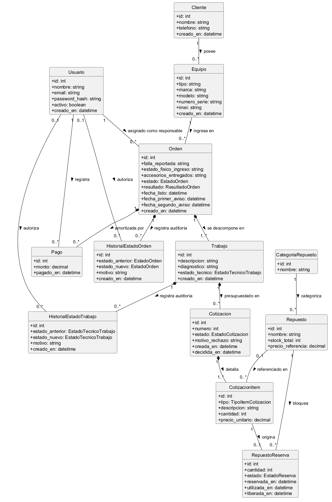
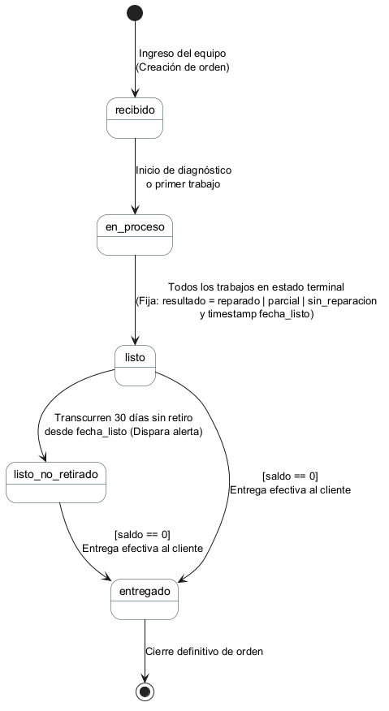
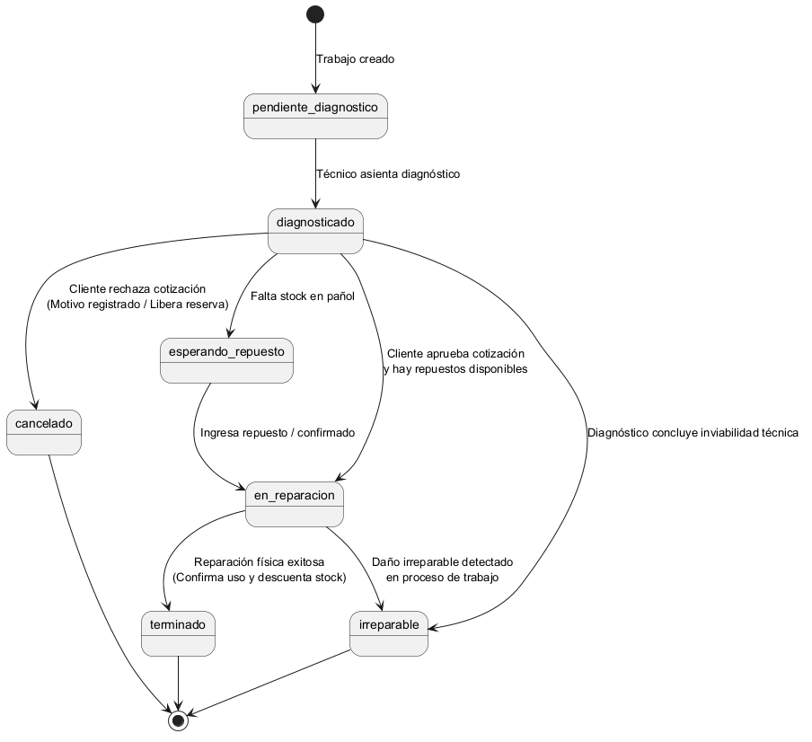
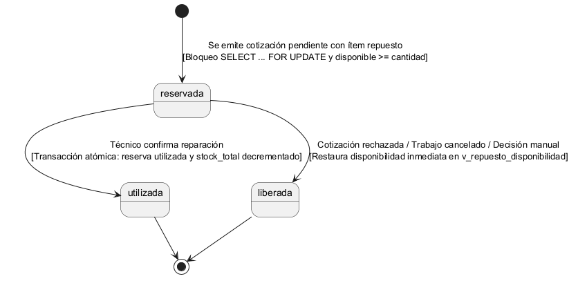

# 07 — Modelo de Dominio y Máquinas de Estado

## 1. Modelo Conceptual de Dominio

El diseño del dominio de TechFlow responde a la necesidad de resolver la inconsistencia identificada por el tutor en la 2.ª Devolución: una orden de trabajo real no puede gobernarse por un único estado monolítico, ya que dentro de un mismo dispositivo coexisten fallas de distinta naturaleza, plazos de repuestos disímiles y respuestas independientes del cliente.

### 1.1. Principios Estructurales del Dominio
1. **Separación de Identidad y Visita:** `Cliente` y `Equipo` representan entidades maestras de largo plazo. Una notebook o celular puede reingresar al taller meses después por otra causa; la entidad `Orden` representa ese ingreso específico.
2. **Desagregación en Trabajos Independientes:** La `Orden` agrupa una colección de `Trabajos`. Cada trabajo encapsula una falla o tarea puntual, su diagnóstico técnico y su estado operativo particular.
3. **Cotizaciones Asignadas a Trabajos:** La cotización no es un presupuesto global de toda la orden que se reemplaza por completo, sino una propuesta económica específica por trabajo (`trabajo_id`), con ítems de snapshot y reservas de pañol asociadas.
4. **Desacople entre Estado Técnico y Financiero:** La orden no posee un campo editable de cobro. Los pagos son transacciones independientes, y el saldo deudor se calcula de forma reactiva y determinística.

### 1.2. Diagrama de Clases del Dominio


Fuente editable en [`diagramas/dominio/modelo_dominio.puml`](diagramas/dominio/modelo_dominio.puml).

---

## 2. Máquina de Estados de la Orden de Trabajo

La orden mantiene un estado global deliberadamente simple, cuya función es reflejar la etapa macro del equipo en el taller:

```text
  [Ingreso]
      │
      ▼
   recibido  ─────────►  en_proceso  ─────────►  listo  ─────────►  entregado
                            (diagnóstico)          ▲  │                ▲
                                                   │  │                │
                                                   │  ▼                │
                                                   │ listo_no_retirado ─┘
                                                   │ (>30 días)
                                                   └───────────────────┘
```



Fuente editable en [`diagramas/estados/estado_orden.puml`](diagramas/estados/estado_orden.puml).

### 2.1. Matriz de Transiciones de la Orden

| Estado Origen | Estado Destino | Condición de Guarda / Disparador | Acción del Sistema / Efecto Colateral |
|---|---|---|---|
| `[*]` | `recibido` | Creación de orden de ingreso. | Asigna `tecnico_id`. Registra estado físico y accesorios. Inserta en `historial_estados_orden`. |
| `recibido` | `en_proceso` | Alta del primer trabajo o inicio de diagnóstico. | Inserta en `historial_estados_orden`. |
| `en_proceso` | `listo` | **Todos los trabajos asociados alcanzaron estado terminal** (`terminado`, `irreparable`, `cancelado`). | Fija obligatoriamente `resultado` (`reparado`, `parcial`, `sin_reparacion`) y asigna `fecha_listo = now()`. Inserta en historial. |
| `listo` | `listo_no_retirado` | `now() - fecha_listo >= 30 días` y equipo no retirado. | Emite alerta en dashboard. Habilita campo para asentar `fecha_segundo_aviso_no_retirado`. |
| `listo` o `listo_no_retirado` | `entregado` | **Guarda estricta:** `v_orden_saldo.saldo == 0`. | Cierra la orden. Inserta en historial con el usuario que efectúa la entrega física. |

---

## 3. Máquina de Estados del Trabajo Técnico

Cada trabajo técnico describe la evolución de una intervención física en banco:



Fuente editable en [`diagramas/estados/estado_trabajo.puml`](diagramas/estados/estado_trabajo.puml).

### 3.1. Matriz de Transiciones del Trabajo

| Estado Origen | Estado Destino | Condición de Guarda / Disparador | Efecto sobre Stock y Orden |
|---|---|---|---|
| `[*]` | `pendiente_diagnostico` | Creación del trabajo en la orden. | Permite asentar descripción inicial de la falla. |
| `pendiente_diagnostico` | `diagnosticado` | Técnico asienta el texto del diagnóstico. | Habilita la emisión de una cotización para este trabajo. |
| `diagnosticado` | `esperando_repuesto` | Falta de disponibilidad neta en pañol de un componente necesario. | Notifica que el trabajo está pausado a la espera de abastecimiento. |
| `diagnosticado` / `esperando_repuesto` | `en_reparacion` | **El cliente aprueba la cotización** vigente y el repuesto se encuentra disponible. | Trabajo en ejecución física en banco. |
| `en_reparacion` | `terminado` | Reparación física completada satisfactoriamente. | **Transacción atómica obligatoria:** reserva pasa a `utilizada` y decrementa `stock_total`. Si todos los trabajos quedan terminales, la orden pasa a `listo`. |
| `diagnosticado` | `cancelado` | **El cliente rechaza la cotización** vigente. | Exige `motivo_rechazo`. **Libera de inmediato** las reservas de repuesto asociadas (`liberada`). |
| `diagnosticado` / `en_reparacion` | `irreparable` | Se constata daño irreversible en componentes críticos. | Libera reservas si las hubiere. Concluye el trabajo con resultado negativo. |

---

## 4. Ciclo de Vida de Cotizaciones y Reservas de Pañol

### 4.1. Semántica Unificada de Cotizaciones
En respuesta al señalamiento de Oscar Londero (*"Decidan una única semántica: versiones completas o presupuestos/cotizaciones adicionales independientes"*), TechFlow adopta formalmente:

$$\mathbf{Cotizaciones\ Adicionales\ Independientes\ por\ Trabajo}$$

- Cada trabajo técnico posee su propia secuencia de cotizaciones (`numero` = 1, 2...).
- Un trabajo puede tener únicamente **una cotización en estado vigente** (`pendiente` o `aprobada`), garantizado a nivel de base de datos mediante el índice único parcial:
  ```sql
  CREATE UNIQUE INDEX uq_cotizaciones_vigente_por_trabajo
      ON cotizaciones(trabajo_id)
      WHERE estado IN ('pendiente', 'aprobada');
  ```
- Si se requiere renegociar una cotización antes de la aprobación, la previa pasa a estado `reemplazada` o `rechazada`, conservando el snapshot histórico sin borrado físico.
- El total general liquidable de la orden es la sumatoria de las cotizaciones aprobadas de sus trabajos.

### 4.2. Ciclo de Vida de las Reservas (`repuesto_reservas`)


Fuente editable en [`diagramas/estados/estado_reserva.puml`](diagramas/estados/estado_reserva.puml).

```text
                    [Cotización emitida]
                             │
                             ▼
                         reservada
                       /           \
   [Técnico confirma uso]        [Cliente rechaza / Técnico libera]
             │                                     │
             ▼                                     ▼
         utilizada                             liberada
  (descuenta stock_total)            (restaura disponibilidad neta)
```

1. **Estado `reservada`:** Se crea en el instante en que se inserta un ítem de tipo `repuesto` en una cotización `pendiente`. Requiere bloqueo de fila (`SELECT ... FOR UPDATE`) sobre el repuesto para evitar sobre-reserva en condiciones de concurrencia.
2. **Estado `utilizada`:** Se establece cuando el técnico concluye la reparación exitosamente. Se ejecuta dentro de una transacción serializable que decrementa `stock_total` en la tabla maestra `repuestos`.
3. **Estado `liberada`:** Se dispara ante el rechazo de la cotización, la cancelación del trabajo, o la decisión manual del técnico frente a una cotización que permanece sin respuesta del cliente. Restituye inmediatamente la unidad al stock disponible sin tocar `stock_total`.

---

## 5. Arquitectura de Vistas Reactivas (Cero Edición Manual de Saldo)

Para cumplir con la directiva del tutor de que `estado_pago` nunca quede librado a la manipulación subjetiva del usuario, el sistema implementa la lógica financiera en tres vistas de cálculo determinístico:

### 5.1. `v_cotizacion_totales`
Calcula el importe exacto de cada cotización a partir del snapshot inmutable de precios de sus ítems:
$$\text{total} = \sum (\text{cantidad} \times \text{precio\_unitario})$$

### 5.2. `v_orden_saldo`
Cruza el acumulado de cotizaciones aprobadas con la sumatoria de pagos reales registrados para cada orden:
$$\text{total\_aprobado} = \sum \text{cotizaciones\_aprobadas}$$
$$\text{total\_pagado} = \sum \text{pagos.monto}$$
$$\text{saldo} = \text{total\_aprobado} - \text{total\_pagado}$$
$$\text{estado\_pago} = \begin{cases} \text{'pendiente'}, & \text{si } \text{total\_pagado} = 0 \\ \text{'parcial'}, & \text{si } 0 < \text{total\_pagado} < \text{total\_aprobado} \\ \text{'pagado'}, & \text{si } \text{total\_pagado} \ge \text{total\_aprobado} \end{cases}$$

### 5.3. `v_repuesto_disponibilidad`
Mantiene en tiempo real la disponibilidad neta en pañol:
$$\text{disponible} = \text{stock\_total} - \sum \text{reservas}[\text{estado} = \text{'reservada'}]$$
Garantiza que ningún técnico cotice una pieza que ya se encuentra comprometida en otro equipo en el taller.
