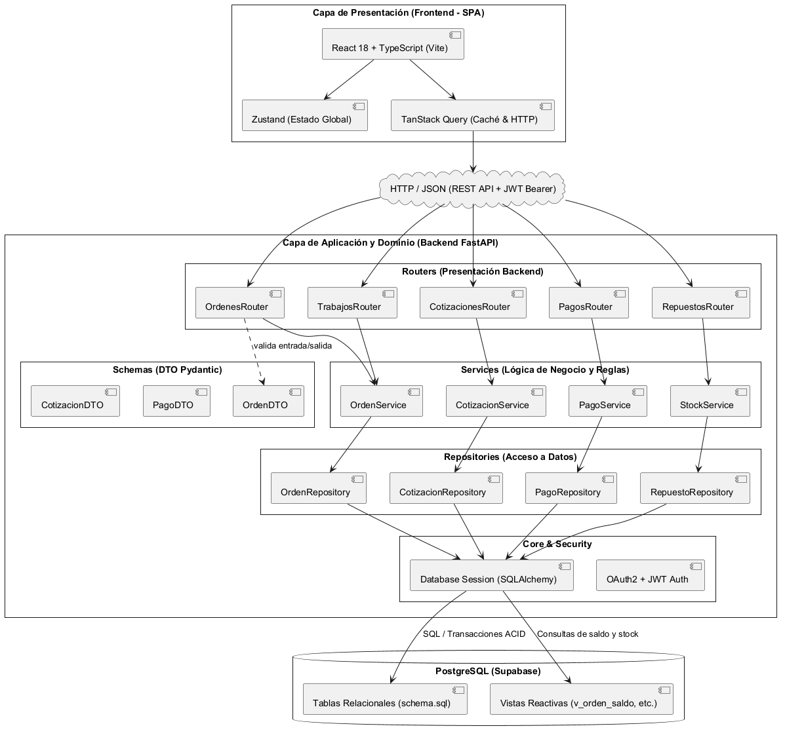
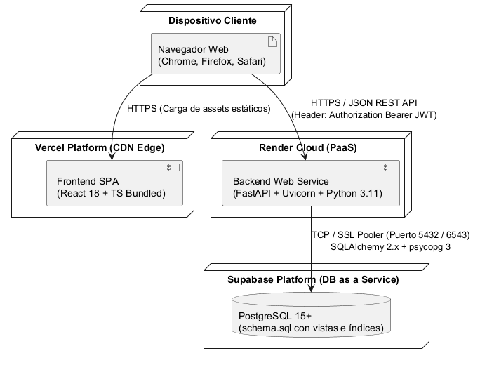

# 10 — Arquitectura Técnica, Patrones de Diseño y Despliegue

## 1. Tipo de Arquitectura

TechFlow adopta una **Arquitectura Cliente-Servidor de N-Capas (Layered Architecture)**, con desacoplamiento físico entre la aplicación cliente (Frontend SPA) y el servidor de aplicaciones (Backend API REST), comunicados exclusivamente mediante el protocolo HTTPS transportando datos en formato JSON.



Fuente editable en [`diagramas/arquitectura/arquitectura_ncapas.puml`](diagramas/arquitectura/arquitectura_ncapas.puml).

```text
┌────────────────────────────────────────────────────────┐
│  CAPA DE PRESENTACIÓN (Frontend - SPA)                 │
│  React 18 + TypeScript (Vite) · Tailwind CSS · Zustand │
└───────────────────────────┬────────────────────────────┘
                            │  HTTPS / JSON (REST API)
                            ▼
┌────────────────────────────────────────────────────────┐
│  CAPA DE SERVICIO Y DOMINIO (Backend - N-Capas)        │
│  FastAPI (Python 3.11) · Routers · Services · Repos    │
└───────────────────────────┬────────────────────────────┘
                            │  SQLAlchemy 2.x (psycopg 3)
                            ▼
┌────────────────────────────────────────────────────────┐
│  CAPA DE PERSISTENCIA (Base de Datos Relacional)       │
│  PostgreSQL (Supabase) · Tablas ACID · Vistas SQL      │
└────────────────────────────────────────────────────────┘
```

### 1.1. Justificación de N-Capas frente a Alternativas
- **Descarte de Microservicios:** Con un equipo de tres desarrolladores y un único proceso de negocio (el ciclo de la orden de reparación), los microservicios introducirían sobrecarga de red, complejidad innecesaria de serialización inter-servicio y orquestación distribuida sin aportar valor.
- **Descarte de Monolito Acoplado (Server-Side Rendering puro):** La separación física Frontend/Backend permite que el equipo avance en paralelo (David en la interfaz React mientras Federico y Brian consolidan los endpoints en FastAPI), utilizando la especificación OpenAPI de Swagger como contrato vinculante.

---

## 2. Stack Tecnológico Definitivo y Justificación Honesta

En cumplimiento con la Observación 10 de la 1.ª Devolución docente, el equipo documenta la elección unificada del stack y el nivel real de dominio de sus integrantes.

### 2.1. Declaración de Competencias del Equipo

> [!IMPORTANT]
> **Pendiente:** cada integrante completa su propia fila (Nulo / Básico / Medio / Avanzado). Oscar pidió el nivel real, así que lo declara cada uno y no lo asume otra persona.

| Integrante | Python / FastAPI | SQL / PostgreSQL | React / TypeScript | Java / Spring Boot | Docker / Despliegue |
|---|---|---|---|---|---|
| **Federico Iacono** |  |  |  |  |  |
| **David Gutiérrez** |  |  |  |  |  |
| **Brian Gutiérrez Colque**|  |  |  |  |  |

> [!NOTE]
> **Resolución definitiva de la disyuntiva Backend:** En las primeras presentaciones se mencionó la posibilidad de emplear Spring Boot o FastAPI. El equipo **cerró definitivamente la decisión en favor de FastAPI (Python)**. La curva de aprendizaje de Spring Boot (Java) y la configuración de su ecosistema empresarial ralentizaban la entrega; FastAPI ofrece tipado estático nativo con Pydantic, generación automática de documentación interactiva Swagger UI y un consumo de memoria extremadamente bajo, ideal para instancias gratuitas en la nube.

### 2.2. Componentes del Stack

| Capa | Tecnología Seleccionada | Justificación Técnica y Operativa |
|---|---|---|
| **Frontend** | **React 18 + TypeScript (Vite)** | • Tipado estático estricto que elimina errores en tiempo de ejecución al manipular DTOs.<br>• Vite como bundler: tiempos de arranque en desarrollo casi instantáneos.<br>• **Tailwind CSS:** desarrollo visual ágil y altamente responsivo sin dispersión en hojas CSS aisladas.<br>• **Zustand:** gestión de estado global sumamente liviana (evitando el boilerplate de Redux).<br>• **TanStack Query:** manejo profesional de caché, revalidación y sincronización de datos con el servidor. |
| **Backend** | **FastAPI (Python 3.11)** | • Rendimiento asíncrono sobre ASGI (Uvicorn).<br>• Validación automática de esquemas de entrada y salida mediante **Pydantic v2**.<br>• Inyección de dependencias nativa (`Depends`) para sesiones de base de datos y autenticación.<br>• Documentación OpenAPI/Swagger autogenerada y disponible en `/docs` para agilizar la integración con el frontend. |
| **Persistencia** | **PostgreSQL (vía Supabase)** | • Motor relacional estándar con soporte estricto de transacciones ACID.<br>• Integridad garantizada mediante restricciones `CHECK`, claves foráneas restrictivas e índices únicos parciales.<br>• Manejo de vistas reactivas para derivación automática de saldos y disponibilidad de pañol.<br>• **Aclaración:** Supabase se utiliza puramente como *PostgreSQL administrado en la nube*; no se utiliza su cliente JavaScript, ni sus APIs autogeneradas ni su módulo de autenticación privativo. |
| **Despliegue** | **Vercel (Front) + Render (Back)** | • Vercel: CDN global y build automatizado conectado al repositorio de GitHub.<br>• Render: hosting de aplicaciones Python con soporte nativo de variables de entorno y reinicio automático. |

---

## 3. Patrones de Diseño Aplicados

| Patrón | Clasificación | Justificación y Aplicación Concreta en TechFlow |
|---|---|---|
| **Repository** | Arquitectónico | Aísla completamente las consultas SQLAlchemy de la lógica de negocio. Si una consulta de persistencia cambia, los servicios no sufren impacto. Ejemplos: `OrdenRepository`, `CotizacionRepository`, `RepuestoRepository`. |
| **Service Layer** | Arquitectónico | Orquesta los casos de uso y aplica las reglas de negocio del dominio (ej. verificar que todos los trabajos estén concluidos antes de habilitar el paso a `listo`, o validar que no haya saldo pendiente antes de entregar). Ejemplos: `OrdenService`, `StockService`. |
| **DTO (Data Transfer Object)** | Estructural | Modelos Pydantic específicos para request/response de la API. Desacopla la representación pública JSON de la estructura de tablas de la base de datos, evitando fugas de campos internos como `password_hash`. |
| **State** | Comportamiento (GoF) | Modela la máquina de estados de las órdenes y de los trabajos. Cada transición valida precondiciones y restricciones antes de ejecutar la mutación. |
| **Bloqueo Pesimista (Pessimistic Locking)** | Concurrencia | Ejecución de `SELECT ... FOR UPDATE` sobre la tabla `repuestos` durante la reserva en pañol, impidiendo sobreventas en accesos concurrentes simultáneos. |
| **Facade** | Estructural (GoF) | Los Routers de FastAPI actúan como fachadas ante el cliente HTTP: exponen una interfaz REST limpia que coordina múltiples llamadas a repositorios y servicios internos. |

---

## 4. Principios SOLID en la Implementación

1. **Single Responsibility Principle (S):** Cada clase y módulo posee una única razón para cambiar. Los *Routers* solo deserializan HTTP y devuelven respuestas de estado; los *Services* solo ejecutan reglas de negocio; los *Repositories* solo dialogan con SQLAlchemy.
2. **Open/Closed Principle (O):** La estructura de estados y cálculo de saldos está abierta a nuevas extensiones (por ejemplo, incorporar pasarelas de pago o nuevas vistas) sin modificar el núcleo de persistencia existente.
3. **Liskov Substitution Principle (L):** Las dependencias de base de datos e interfaces de repositorios pueden ser sustituidas por dobles de prueba (mocks o bases en memoria SQLite) durante la ejecución de los tests automatizados sin alterar el comportamiento de los servicios.
4. **Interface Segregation Principle (I):** Los DTOs de entrada y salida están rigurosamente segregados: `OrdenCreateDTO` no exige campos que solo existen al consultar `OrdenDetailDTO` (como fechas de auditoría o saldos derivados).
5. **Dependency Inversion Principle (D):** Los servicios y routers no instancian directamente sesiones de base de datos acopladas, sino que reciben sus dependencias inyectadas a través del mecanismo `Depends(get_db)` de FastAPI.

---

## 5. Seguridad y Autenticación

En respuesta a la 2.ª Devolución (*"OAuth2 + JWT pero no existe entidad de usuario en el modelo"*):
- Se modeló la entidad `usuarios` en PostgreSQL con email único y `password_hash`.
- El flujo de autenticación implementa **OAuth2 con Password Bearer Flow**:
  1. El cliente envía `POST /api/v1/auth/login` con credenciales (email y contraseña).
  2. El backend verifica la contraseña contra el hash mediante `passlib` (Bcrypt).
  3. Si es válida, emite un token **JWT (JSON Web Token)** firmado criptográficamente con algoritmo HMAC-SHA256, con vencimiento configurable y el identificador `sub = usuario.id`.
  4. El frontend almacena el token y lo adjunta en cada petición protegida en el encabezado:
     ```http
     Authorization: Bearer <token_jwt>
     ```
  5. El usuario autenticado es extraído por el backend y vinculado automáticamente como autor en las transiciones de estado (`historial_estados_*`) y receptor de pagos (`pagos.registrado_por`).

---

## 6. Diagrama de Despliegue en la Nube



Fuente editable en [`diagramas/arquitectura/despliegue.puml`](diagramas/arquitectura/despliegue.puml).

```text
[ Navegador Web ]
       │
       ├──► HTTPS (Assets estáticos) ──────► [ Vercel: React SPA ]
       │
       └──► HTTPS / JSON (API REST) ───────► [ Render: FastAPI + Uvicorn ]
                                                    │
                                                    ▼ TCP / SSL Pooler (6543)
                                             [ Supabase: PostgreSQL ]
```

---

## 7. Contratos de la API REST (Endpoints Núcleo P0)

```text
AUTENTICACIÓN:
POST   /api/v1/auth/login                  -> Emite JWT para usuario válido

CLIENTES Y EQUIPOS:
GET    /api/v1/clientes                    -> Búsqueda y listado de clientes
POST   /api/v1/clientes                    -> Alta de cliente
POST   /api/v1/clientes/{id}/equipos       -> Alta de equipo asociado

ÓRDENES DE TRABAJO:
GET    /api/v1/ordenes                     -> Listado de órdenes con filtros de estado
POST   /api/v1/ordenes                     -> Apertura de orden (con técnico_id)
GET    /api/v1/ordenes/{id}                -> Detalle completo con trabajos, cotizaciones y saldo
PATCH  /api/v1/ordenes/{id}/estado         -> Transición de estado global (valida saldo en 'entregado')
GET    /api/v1/ordenes/{id}/mensaje-estado -> Genera el texto formateado para WhatsApp

TRABAJOS Y COTIZACIONES:
POST   /api/v1/ordenes/{id}/trabajos       -> Agrega un trabajo a la orden
PATCH  /api/v1/trabajos/{id}/estado        -> Modifica el estado técnico del trabajo
POST   /api/v1/trabajos/{id}/cotizaciones  -> Crea cotización independiente con reserva de pañol
PATCH  /api/v1/cotizaciones/{id}/estado    -> Registra aprobación o rechazo (libera reserva)
POST   /api/v1/trabajos/{id}/confirmar-uso -> Transacción atómica: reserva utilizada + decremento stock

PAGOS:
POST   /api/v1/ordenes/{id}/pagos          -> Registra pago (valida monto > 0)

REPUESTOS:
GET    /api/v1/repuestos                   -> Catálogo con disponibilidad neta (vista SQL)
```
