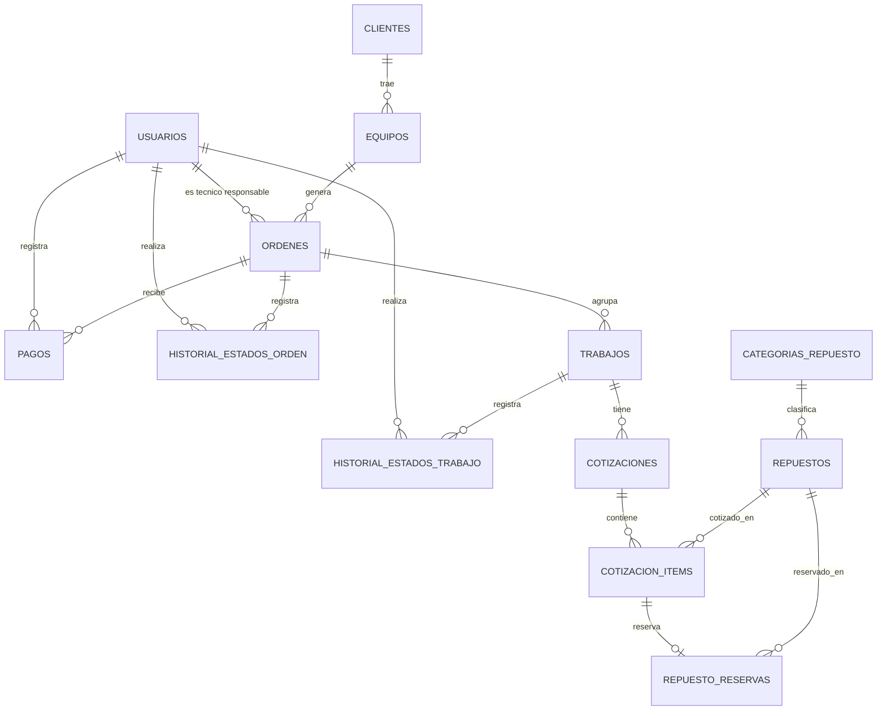

# Esquema de base de datos — P0

Motor: PostgreSQL. Script completo en `database/postgresql/schema.sql`.

## Modelo en síntesis

- Una **orden** representa un ingreso de un equipo y tiene un estado global simple (`recibido`, `en_proceso`, `listo`, `listo_no_retirado`, `entregado`) y un `resultado` (`reparado`, `parcial`, `sin_reparacion`) que se fija al pasar a `listo`.
- Cada orden agrupa uno o más **trabajos**. Cada trabajo tiene su diagnóstico y su propio estado técnico (`pendiente_diagnostico`, `diagnosticado`, `esperando_repuesto`, `en_reparacion`, `terminado`, `irreparable`, `cancelado`). Así, en una misma orden un trabajo puede estar esperando repuesto mientras otro ya está terminado.
- Cada trabajo tiene sus **cotizaciones**: son cotizaciones independientes, no versiones completas de la orden. Solo puede haber una cotización vigente (`pendiente` o `aprobada`) por trabajo; las rechazadas o reemplazadas nunca se borran. Una falla nueva durante la reparación se modela como un trabajo nuevo con su cotización.
- El **total de la orden** es la suma de sus cotizaciones aprobadas. Totales, saldo y estado de pago no se guardan: se derivan en vistas.
- El estado de **cada trabajo y de la orden** cambia de forma trazable: cada transición queda en un historial con el usuario que la hizo.

## Diagrama entidad-relación

## Tablas y propósito

| Tabla | Propósito |
|---|---|
| `usuarios` | Identidad mínima (nombre, email único, hash de contraseña, activo) para autenticación y trazabilidad. Sin matriz de roles en el P0. |
| `clientes` | Datos de contacto de quien trae el equipo. |
| `equipos` | Datos estables del dispositivo: tipo genérico, marca (opcional), modelo, número de serie (opcional) e IMEI (opcional). |
| `ordenes` | Un ingreso de equipo: técnico responsable, falla reportada, estado físico y accesorios de ese ingreso, estado global simple y resultado. |
| `trabajos` | Falla o tarea concreta dentro de la orden, con diagnóstico y estado técnico propio. |
| `cotizaciones` | Cotizaciones de un trabajo: número secuencial por trabajo, estado (`pendiente`, `aprobada`, `rechazada`, `reemplazada`), motivo de rechazo y fechas. Nunca se borran. Índice único parcial: una sola vigente por trabajo. |
| `cotizacion_items` | Ítems de una cotización (`repuesto`, `mano_obra`, `descripcion`) con cantidad y precio unitario como snapshot del precio aplicado. Sin columna de total. |
| `categorias_repuesto` / `repuestos` | Catálogo de repuestos, `stock_total` (nunca negativo) y `precio_referencia` (solo referencia del catálogo). |
| `repuesto_reservas` | Reserva de un ítem de cotización: cantidad y estado (`reservada`, `utilizada`, `liberada`). |
| `pagos` | Pagos de una orden (`monto > 0`), con el usuario que los registró. Permite pagos parciales. |
| `historial_estados_orden` / `historial_estados_trabajo` | Una fila por cambio de estado: estado anterior, estado nuevo, usuario, motivo opcional y fecha. |
| `v_cotizacion_totales` | Total de cada cotización (suma de cantidad × precio unitario). |
| `v_orden_saldo` | Total aprobado, total pagado, saldo y `estado_pago` derivado (`pendiente`, `parcial`, `pagado`). |
| `v_trabajo_decision_cliente` | Decisión del cliente por trabajo, derivada de su última cotización. |
| `v_repuesto_disponibilidad` | `stock_total` menos reservas en estado `reservada`. |

## Trazabilidad regla de negocio → diseño

Reglas según `Caso-Completo-Reparacion.md`, sección 4. Ninguna fue validada por un negocio real salvo lo indicado como "Relevada" en esa sección; la columna de origen vive allí.

1. **Una cotización rechazada o reemplazada nunca se borra.** → `cotizaciones` conserva todas las cotizaciones de un trabajo (`numero` secuencial, `UNIQUE (trabajo_id, numero)`) con su estado (`rechazada`, `reemplazada`) y `motivo_rechazo`. No hay operación de borrado; el índice único parcial `uq_cotizaciones_vigente_por_trabajo` garantiza una sola cotización vigente por trabajo.
2. **Un repuesto se reserva al cotizarlo y se descuenta del stock solo cuando el técnico confirma su uso.** → `repuesto_reservas.estado` distingue `reservada`, `utilizada` y `liberada`. La disponibilidad efectiva es `stock_total` menos las reservas `reservada` (`v_repuesto_disponibilidad`). Si la cotización se rechaza, la reserva pasa a `liberada` y el repuesto vuelve a estar disponible. `stock_total` se decrementa en la misma transacción que pasa la reserva a `utilizada` (regla de backend, ver pruebas obligatorias).
3. **Una falla nueva no bloquea lo ya aprobado de la misma orden.** → Cada falla es un `trabajo` con estado técnico y cotización propios; aprobar, rechazar o demorar un trabajo no afecta a los demás de la orden. La orden avanza a `listo` cuando todos sus trabajos llegan a un estado terminal (`terminado`, `irreparable` o `cancelado`), y el `resultado` (`reparado`, `parcial` o `sin_reparacion`) refleja qué se logró.
4. **Estado técnico y estado de pago son campos separados.** → El estado técnico vive en `trabajos.estado_tecnico` y el estado global en `ordenes.estado`. El estado de pago no es una columna: se deriva en `v_orden_saldo` a partir de las cotizaciones aprobadas y los pagos, por lo que no puede editarse a mano ni quedar desincronizado.
5. **No se almacena PIN/contraseña del equipo.** → No hay columna para ese dato en `equipos` ni en ninguna otra tabla.
6. **Equipo `Listo` sin retirar pasa a alerta a los 30 días, con segundo aviso documentado.** → `ordenes.fecha_listo`, `fecha_primer_aviso_no_retirado` y `fecha_segundo_aviso_no_retirado` permiten calcular y dejar constancia del vencimiento sin una tabla aparte. La transición a `listo_no_retirado` queda en `historial_estados_orden`.
7. **No se habla de "rentabilidad neta", solo margen por reparación.** → No es una restricción de esquema; se resuelve en la capa de reportes. **Limitación:** el precio unitario del ítem es un snapshot del precio al cliente, pero el esquema no conserva el costo histórico de repuestos ni define el costo real de mano de obra, por lo que el margen todavía no es confiable; el cálculo queda pospuesto hasta definir una política de costos.
8. **Una orden no pasa a `entregado` con saldo pendiente.** → No se resuelve en el DDL. Es una regla de backend (saldo = total aprobado − total pagado, consultable en `v_orden_saldo`) con test obligatorio (ver más abajo).
9. **El cliente puede consultar el estado sin escribir al técnico.** → Sin tabla propia en el P0: el sistema genera un mensaje de estado a partir del estado de la orden y de sus trabajos, y el técnico lo copia con un botón "copiar mensaje de estado" (sin integrar WhatsApp). Más adelante, un enlace seguro de consulta.

## Pruebas obligatorias de backend

Las reglas que el DDL no puede garantizar por sí solo se cubren con tests automáticos en el backend. Son obligatorias para dar por implementado el recorrido:

1. **Saldo pendiente impide entregar.** Una orden con `saldo > 0` en `v_orden_saldo` no puede pasar a `entregado`; con saldo cero (o pagos completos) sí puede. Además, la orden sin reparación (`resultado = sin_reparacion`, total aprobado cero) puede pasar a `entregado` sin pagos.
2. **Monto mayor a cero.** Registrar un pago con `monto <= 0` es rechazado (la restricción `CHECK (monto > 0)` y la validación del backend deben coincidir).
3. **Reserva concurrente con stock = 1.** Con un repuesto con stock disponible igual a 1, dos órdenes intentan reservarlo a la vez (dos transacciones simultáneas): solo una logra la reserva y la otra recibe un error de stock insuficiente. La reserva debe tomar el bloqueo de fila del repuesto (`SELECT ... FOR UPDATE`) antes de verificar la disponibilidad.
4. **Rechazo o falta de respuesta libera la reserva.** Cuando una cotización se rechaza, sus reservas pasan a `liberada` y la disponibilidad se recupera. Una cotización **sin respuesta** del cliente queda `pendiente` (sin vencimiento automático en el P0) y mantiene su reserva hasta que el técnico decida manualmente liberarla; tras esa liberación el repuesto vuelve a estar disponible. Un test verifica ambos caminos.
5. **Uso del repuesto es atómico.** Pasar una reserva de `reservada` a `utilizada` y decrementar `repuestos.stock_total` ocurren en la misma transacción: si una falla, ninguna se aplica.
6. **Una sola cotización vigente por trabajo.** Crear una segunda cotización pendiente o aprobada para un trabajo que ya tiene una vigente es rechazado (también garantizado por el índice único parcial).
7. **Cierre sin reparación.** Si todos los trabajos quedan `irreparable` o `cancelado`, la orden pasa a `listo` con `resultado = sin_reparacion` y luego a `entregado`, sin pasar por estados de reparación.

## Fuera de este esquema

Cuenta corriente, proveedores/compras, matriz de roles de usuario y métricas/IA no se modelan en el P0 (ver `Modulos-P0.md`). Los usuarios existen para autenticar y dejar trazabilidad, no para diferenciar permisos todavía.
