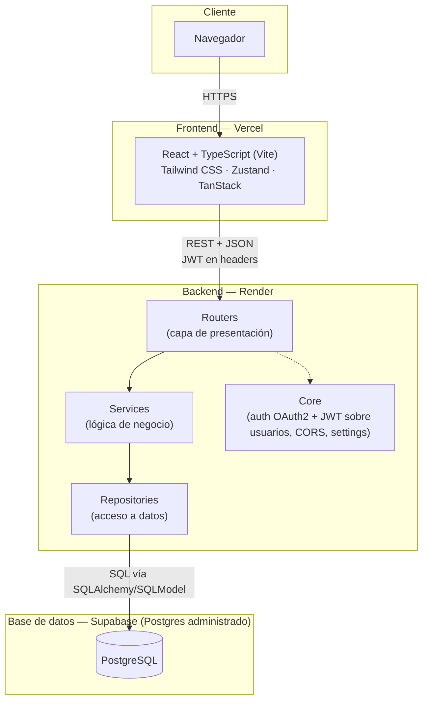

# Arquitectura — P0

## Diagrama de arquitectura

## Componentes

| Componente | Responsabilidad | Detalle |
|---|---|---|
| Frontend (React) | UI y estado de cliente | Consume la API REST del backend, ver [`frontend/README.md`](../../frontend/README.md) |
| Backend (FastAPI) | Lógica de negocio y acceso a datos, organizado en N-capas | Ver [`backend/README.md`](../../backend/README.md) |
| Base de datos (PostgreSQL) | Persistencia única del sistema | Esquema en [`Esquema-Base-Datos.md`](Esquema-Base-Datos.md) y [`database/postgresql/schema.sql`](../../database/postgresql/schema.sql) |

## Flujo de una petición

1. El navegador carga la SPA de React servida desde Vercel.
2. React llama a la API REST del backend (Render) por HTTPS, adjuntando el JWT emitido en el login. El login valida email y hash de contraseña contra la tabla `usuarios`; el usuario autenticado queda como técnico responsable de las órdenes y como autor de los cambios de estado y de los pagos.
3. El router valida la petición y delega en el service correspondiente.
4. El service aplica la lógica de negocio (por ejemplo, la máquina de estados de órdenes y trabajos, la regla de no entregar con saldo pendiente y la reserva de repuestos con bloqueo de fila) y llama al repository.
5. El repository ejecuta la consulta contra PostgreSQL (Supabase) vía SQLAlchemy/SQLModel.
6. La respuesta viaja de vuelta por las mismas capas hasta el cliente.

## Fuera de esta instancia

No hay despliegue real todavía: Vercel, Render y Supabase son las plataformas elegidas para la Entrega Final. En esta entrega (2.ª) se define la arquitectura; el código se construye de forma incremental, empezando por un recorrido ejecutable pequeño que valide el modelo (ver [`backend/README.md`](../../backend/README.md)). La matriz de roles queda fuera del P0: `usuarios` aporta identidad, no permisos diferenciados.
